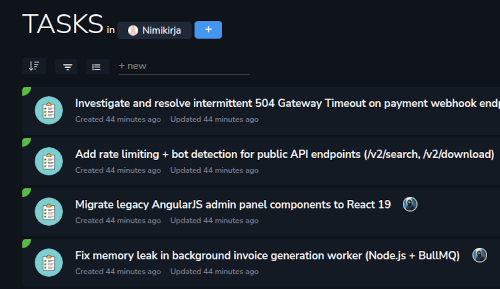

# Aamu.app: a monday.com alternative for project work with company contextA practical comparison of Aamu.app and monday.com for teams that want project management connected to customer conversations, email, meetings, databases, and shared knowledge.Published: 2026-08-24

<strong>Short answer:</strong> Aamu.app is a monday.com alternative for teams that want visual project work connected to Helpdesk, email, meetings, databases, and permission-aware company knowledge in one workspace.

A request can move through a board while the customer conversation, supporting document and next decision need separate attention. Evaluate a monday.com alternative by following that request through the products, integrations and people needed to finish it.

Comparison reviewed on 21 October 2026 from Aamu’s product perspective. Product documentation and pricing sources are linked below.
<h2>Quick comparison</h2><table style="min-width: 100px;"><colgroup><col style="min-width: 25px;"><col style="min-width: 25px;"><col style="min-width: 25px;"><col style="min-width: 25px;"></colgroup><tbody><tr><th>
Product
</th><th>
Best fit
</th><th>
Starting price / billing basis
</th><th>
What to check
</th></tr><tr><td colspan="1" rowspan="1">
<a target="_blank" rel="noopener noreferrer nofollow" href="https://aamu.app/blog/posts/aamuapp-tasks-feature-overview/">Aamu.app</a>
</td><td colspan="1" rowspan="1">
Teams coordinating customer requests and everyday project work together.
</td><td colspan="1" rowspan="1">
Limited free plan; US$1/month minimum plus resource usage. AI costs extra.
</td><td colspan="1" rowspan="1">
Check advanced planning and cross-team reporting requirements.
</td></tr><tr><td colspan="1" rowspan="1">
<a target="_blank" rel="noopener noreferrer nofollow" href="https://monday.com/pricing">monday work management / AI work platform</a>
</td><td colspan="1" rowspan="1">
Configurable boards, views, dashboards and automation.
</td><td colspan="1" rowspan="1">
Free: up to 2 seats. Basic: US$9/seat/month billed annually, with paid seat-bucket minimums.
</td><td colspan="1" rowspan="1">
CRM, dev and service are separately priced products; check the full bundle.
</td></tr></tbody></table>
USD prices and plan conditions checked on 21 October 2026. Verify current regional prices, taxes and billing terms using the linked sources. <a target="_blank" rel="noopener noreferrer nofollow" href="https://aamu.app/">Aamu’s free plan</a> includes 25 MB of file storage; AI is billed separately by your provider.
<h2>Aamu: Tasks alongside support, Docs and Databases</h2>
Aamu supports Tasks, boards, timelines, Calendar, custom fields, statuses, relationships, recurrence and assignments alongside customer support, Docs and Databases.

A task can be connected to the source that gave it a reason to exist:
<ul><li>
<strong>Helpdesk and Livechat:</strong> a customer question can become a concrete follow-up without losing the conversation.
</li><li>
<strong>Email and Meetings:</strong> a decision or request can lead to work while the original correspondence and notes remain nearby.
</li><li>
<strong>Docs and Databases:</strong> the team can keep instructions, decisions, records, and execution linked in the same workspace.
</li><li>
<strong>Company Brain and Team Brain:</strong> permission-aware shared knowledge can help the team find existing context before creating another answer or task.
</li></ul>
The task list in Aamu’s public product example. <a target="_blank" rel="noopener noreferrer nofollow" href="https://aamu.app/blog/posts/aamuapp-tasks-feature-overview/">Explore task views, dates and relationships.</a>
<h2>monday.com is a configurable Work OS</h2>
monday.com is a natural fit when a team wants to design its own operating model. Boards can represent projects, campaigns, sales pipelines, service workflows, product roadmaps, or internal processes. Views, columns, automations, dashboards, and templates help different teams shape the same platform around their own work.

The current monday.com Work OS positioning reaches beyond project tracking into areas such as task management, CRM, marketing, IT, and cross-functional operations. That breadth is valuable when an organization wants one configurable foundation for several departments. See the <a target="_blank" rel="noopener noreferrer nofollow" href="https://monday.com/work">monday.com Work OS overview</a> for the current product scope.

For teams with a clear process to model, this flexibility is a strength. A project manager can choose the fields, statuses, dependencies, views, and reports that make progress visible without forcing every department into exactly the same workflow.

The vendor’s current <a target="_blank" rel="noopener noreferrer nofollow" href="https://support.monday.com/hc/en-us/articles/4405633151634-Plans-and-pricing-for-monday-com">billing guide</a> calls its general work product the monday AI work platform. It explains separately priced products and paid subscriptions starting at three seats, followed by seat buckets. Match the product and purchased seat count to your actual workflow.
<h2>The real comparison: flexible Work OS or connected company workspace?</h2>
monday.com's strength is its flexible model. Teams can represent work as boards and items, then build views and automations around that model. This is especially useful when the main challenge is standardizing how projects move through stages.

monday.com also offers <a target="_blank" rel="noopener noreferrer nofollow" href="https://monday.com/crm">monday CRM</a> and <a target="_blank" rel="noopener noreferrer nofollow" href="https://support.monday.com/hc/en-us/articles/16810835014546-Get-started-with-monday-service">monday service</a>. This article compares Aamu mainly with monday work management; a wider evaluation should include the relevant monday products and plans.
<h2>From request to delivered work</h2>
Imagine a customer asks whether an integration is supported. The question contains more than a reply: it may reveal a product gap, require a documentation update, and create work for someone on the team.
<ol><li>
The question arrives in Helpdesk, Livechat, or email.
</li><li>
The team retrieves the relevant Doc or Company Brain context and prepares a human-reviewed answer.
</li><li>
If the answer is incomplete, Aamu creates a Task for product or support and links it to the original conversation.
</li><li>
A meeting can record the decision, while a Doc becomes the maintained explanation for future questions.
</li><li>
The source is updated when the work is complete, so the next answer starts with better context.
</li></ol>
monday work management can represent the request as a board item and automate its handoff. monday service adds a dedicated ticket workflow. Compare those options with Aamu’s project-based Helpdesk, Tasks and maintained knowledge.
<h2>Project planning is where monday.com is stronger</h2>
For serious project planning, monday.com has a broader dedicated layer. Its current project-management offering emphasizes Gantt views, milestones, dependencies, critical paths, workload and resource views, portfolio dashboards, risk visibility, and AI-assisted project reporting. Its AI project-management overview describes plans with tasks, owners, dependencies, and Gantt views as well as tools for analyzing risks and reporting status.

Those capabilities matter when a project manager or PMO needs to coordinate many projects, see capacity across teams, understand schedule impact, or report progress to leadership. monday.com is often the more natural starting point when portfolio planning and workflow configuration are the primary buying criteria.

Aamu can organize Tasks with dates, statuses, relations, and project context, but it is not trying to turn every small team into a PMO. If advanced portfolio planning, resource capacity, and dependency-heavy schedules are the heart of the problem, monday.com deserves a close look.
<h2>AI and the sources behind an answer</h2>
Both products use AI to reduce manual project work. monday.com can help generate project plans, summarize work, identify risks, and produce status-oriented insights from the project data stored in its platform.

Aamu's AI angle is different. It can use the current item together with permission-aware Company Brain or Team Brain context, and it can support workflows around Helpdesk and email reply drafts, Docs, Tasks, Meetings, and Databases. The intended benefit is not simply a faster board update; it is less searching before a human decides what to do and how to explain it.

For either product, check which sources AI can use, how permissions apply and which actions need review. The answer depends on the configured products, integrations and workflow.
<h2>When monday.com may be the better choice</h2><ul><li>
The organization needs highly configurable workflows used by several departments.
</li><li>
Project managers need portfolio dashboards, Gantt dependencies, workload, resource, or capacity visibility.
</li><li>
The team wants to standardize processes with templates, no-code automations, and custom views.
</li><li>
The main source of truth is already a project or operations board, with other systems connected around it.
</li></ul><h2>When Aamu.app may be the better choice</h2><ul><li>
Support questions, customer emails, meetings, and internal projects regularly turn into one another.
</li><li>
The team wants Docs, Databases, Tasks, customer conversations, and meetings in one operational workspace.
</li><li>
The team wants AI to retrieve accessible Aamu tasks, Docs, meetings, database records and support knowledge.
</li><li>
A small or growing team wants fewer handoffs between support, knowledge, and execution systems.
</li><li>
The reason behind a Task is as important as its owner and due date.
</li></ul><h2>Before you switch</h2><h3>Does the per-seat price equal our total bill?</h3>
Use the purchased seat bucket rather than just the number of active teammates. Include the required monday products, automation and AI allowances, and billing term. Compare with Aamu’s resource usage and separate AI provider charges.
<h3>Can we move boards without rebuilding the process?</h3>
Pilot representative columns, statuses, linked items, formulas, automations and permissions. Decide how each becomes an Aamu Task or Database record, and verify the resulting workflow before moving active boards.
<h3>What about CRM, service and portfolio planning?</h3>
Evaluate the relevant monday products as a bundle when you use them. Aamu includes Helpdesk and Databases, but you should test your actual sales, service and portfolio requirements instead of assuming identical feature depth.
<h2>Pilot one request and its follow-up</h2>
monday.com deserves a close look for configurable departmental workflows and portfolio planning. Try Aamu when the request, customer conversation, knowledge and assigned work need to stay in one project workspace. <a target="_blank" rel="noopener noreferrer nofollow" href="https://aamu.app/">Create an Aamu workspace</a> and run that pilot with the people who will use it.
<h2>Frequently asked questions</h2><h3>Is Aamu.app a monday.com alternative?</h3>
Yes. Aamu.app is an alternative for teams that want project management connected to customer conversations, email, meetings, databases, Docs, and shared company knowledge in one workspace.
<h3>How is Aamu.app different from monday.com?</h3>
This article focuses on monday work management. monday.com also offers CRM and service products, so compare the relevant product combination with Aamu’s Tasks, Helpdesk, Docs, email, meetings, Databases and Company Brain.
<h3>When is monday.com the better choice?</h3>
monday.com may be the better fit when a team needs broad workflow configuration, portfolio dashboards, workload and resource planning, Gantt charts with dependencies, templates, and no-code automations across many departments.
<h2>Related articles</h2><ul><li><a href="/blog/posts/aamuapp-vs-clickup-connected-workspace-and-shared-context/">aamuapp vs clickup connected workspace and shared context</a></li><li><a href="/blog/posts/aamuapp-vs-basecamp-project-context-and-customer-work/">aamuapp vs basecamp project context and customer work</a></li><li><a href="/blog/posts/aamuapp-vs-asana-tasks-and-shared-context/">aamuapp vs asana tasks and shared context</a></li><li><a href="/blog/posts/aamuapp-as-an-ai-workspace-alternative-to-notion-ai-slack-ai-jira-and-zendesk/">Aamu.app as an AI workspace alternative to Notion AI, Slack AI, Jira, and Zendesk</a></li><li><a href="/blog/posts/company-brain-in-aamuapp-ai-across-your-workspace/">Company Brain in Aamu.app: AI across your workspace</a></li></ul>
