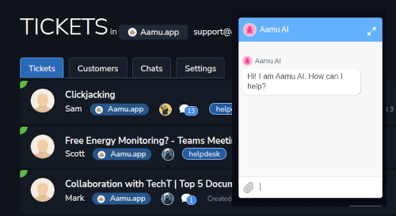

# Aamu.app: an Intercom alternative connecting support and product workA practical comparison of Aamu.app and Intercom for teams that want customer conversations, support knowledge, and internal follow-up in one workspace.Published: 2026-07-24

<strong>Short answer:</strong> Aamu.app is an Intercom alternative for teams that want customer conversations, support knowledge, and internal follow-up in one connected workspace.

A support answer can require a product decision, an internal task and a documentation change. If those handoffs are difficult to follow, evaluate an Intercom alternative with a real customer request that needs help from the rest of the team.

Comparison reviewed on 21 October 2026 from Aamu’s product perspective. Product documentation and pricing sources are linked below.
<h2>Quick comparison</h2><table style="min-width: 100px;"><colgroup><col style="min-width: 25px;"><col style="min-width: 25px;"><col style="min-width: 25px;"><col style="min-width: 25px;"></colgroup><tbody><tr><th>
Product
</th><th>
Best fit
</th><th>
Starting price / billing basis
</th><th>
What to check
</th></tr><tr><td colspan="1" rowspan="1">
<a target="_blank" rel="noopener noreferrer nofollow" href="https://aamu.app/blog/posts/aamuapp-helpdesk-feature-overview/">Aamu.app</a>
</td><td colspan="1" rowspan="1">
Support teams that also own product follow-up and documentation.
</td><td colspan="1" rowspan="1">
Limited free plan; US$1/month minimum plus resource usage. AI costs extra.
</td><td colspan="1" rowspan="1">
Test required channels, escalation and source quality.
</td></tr><tr><td colspan="1" rowspan="1">
<a target="_blank" rel="noopener noreferrer nofollow" href="https://www.intercom.com/pricing">Intercom</a>
</td><td colspan="1" rowspan="1">
Dedicated customer messaging, ticketing and Fin automation.
</td><td colspan="1" rowspan="1">
Essential: US$29/seat/month on annual billing; Fin from US$0.99/outcome.
</td><td colspan="1" rowspan="1">
Include outcome usage, paid channels and relevant add-ons.
</td></tr></tbody></table>
USD prices and plan conditions checked on 21 October 2026. Verify current regional prices, taxes and billing terms using the linked sources. <a target="_blank" rel="noopener noreferrer nofollow" href="https://aamu.app/">Aamu’s free plan</a> includes 25 MB of file storage; AI is billed separately by your provider.
<h2>Aamu: support connected to the work behind the answer</h2>
A customer asks how a feature works. Team Brain or Helpdesk Knowledge Base finds the maintained source. Aamu can prepare a reply draft for human review. If the answer is missing, the team can create a Doc or Task. The improved source then helps with the next similar question.

This can suit a small team where the same people answer customers, fix problems and maintain documentation.

Intercom also maintains and retrieves support knowledge through <a target="_blank" rel="noopener noreferrer nofollow" href="https://www.intercom.com/help/en/articles/9440354-knowledge-sources-to-power-ai-agents-and-self-serve-support">Knowledge</a>. Retrieval and a knowledge feedback loop are therefore shared capabilities; compare the wider project workflow and the source integrations your team needs.
<ul><li>
<strong>One support queue:</strong> customer email and website Livechat belong to the Helpdesk project.
</li><li>
<strong>Internal follow-up:</strong> create Tasks from tickets and keep internal comments separate from customer replies.
</li><li>
<strong>Reviewed AI drafts:</strong> use maintained Helpdesk Knowledge Base sources, then review and send the reply.
</li></ul>
AI Livechat is configured separately and can answer visitors directly when enabled. <a target="_blank" rel="noopener noreferrer nofollow" href="https://aamu.app/blog/posts/aamuapp-helpdesk-feature-overview/">The Helpdesk guide</a> explains these differences.

Helpdesk and Livechat in Aamu’s public product example. <a target="_blank" rel="noopener noreferrer nofollow" href="https://aamu.app/blog/posts/aamuapp-helpdesk-feature-overview/">See the complete support workflow.</a>
<h2>Intercom is conversation-first</h2>
Intercom is a natural fit when customer messaging and support operations are the central workflow. It helps teams organize conversations and build repeatable ways to serve customers.

Aamu Helpdesk also handles customer conversations, but it sits inside a broader workspace. The same project can contain Docs, Tasks, meetings, email, databases, files, and shared knowledge.

<a target="_blank" rel="noopener noreferrer nofollow" href="https://www.intercom.com/pricing">Intercom’s plan comparison</a> includes shared inboxes, ticketing, Messenger and a public help centre; higher plans add workflow automation and other controls. It is worth evaluating when a dedicated support operation needs those capabilities. Compare the exact channels, reporting and escalation behavior you require in Aamu.
<h2>When Intercom may be the better choice</h2>
Choose Intercom when customer messaging, engagement, and a specialized support operation are the main requirements. Aamu is a strong alternative when support needs to stay close to the internal work behind the answer.
<h2>Before you switch</h2><h3>How do the billing models compare?</h3>
Estimate support seats, Fin outcomes and channel usage for Intercom. Estimate resources and your AI provider’s charges for Aamu. A low starting price does not show the cost of your real ticket volume or required service features.
<h3>What needs checking during a support migration?</h3>
Test a sample of customer histories, attachments, help articles and assignments. Verify the support address and Livechat routing before changing the website widget, and agree where older conversations will remain accessible.
<h3>Can we reproduce our current support automation?</h3>
List each routing rule, escalation, integration and reporting requirement. Exercise those cases in Aamu, including a missing knowledge source and a request for a human. Generated reply drafts and automatic Livechat answers require different review decisions.
<h2>Evaluate one support queue</h2>
Intercom deserves a close look for a specialized messaging and service operation. Start an Aamu pilot when your support queue needs to stay close to the Tasks and Docs maintained by the same team. <a target="_blank" rel="noopener noreferrer nofollow" href="https://aamu.app/">Create an Aamu workspace</a> and run that pilot with the people who will use it.
<h2>Frequently asked questions</h2><h3>Can Aamu.app replace Intercom?</h3>
For some small and growing teams, it can. Aamu.app is a strong fit when customer conversations need to connect with documentation, tasks, and internal knowledge.
<h3>How does Aamu.app AI help with customer support?</h3>
Aamu.app can retrieve context from Team Brain and prepare reply drafts. A human can review important replies before they are sent.
<h3>When is Intercom the better choice?</h3>
Intercom may be the better choice when customer messaging, engagement, and a specialised support operation are the organisation’s main requirements.
<h2>Related articles</h2><ul><li><a href="/blog/posts/aamuapp-vs-asana-tasks-and-shared-context/">aamuapp vs asana tasks and shared context</a></li><li><a href="/blog/posts/aamuapp-as-an-ai-workspace-alternative-to-notion-ai-slack-ai-jira-and-zendesk/">Aamu.app as an AI workspace alternative to Notion AI, Slack AI, Jira, and Zendesk</a></li><li><a href="/blog/posts/ai-support-in-aamuapp/">AI support in Aamu.app</a></li><li><a href="/blog/posts/aamuapp-helpdesk-feature-overview/">Aamu.app Helpdesk - feature overview</a></li><li><a href="/blog/posts/ai-customer-support-with-aamuapp-team-brain-drafts-and-human-review/">AI customer support with Aamu.app: Helpdesk Knowledge Base, drafts, and human review</a></li></ul>
